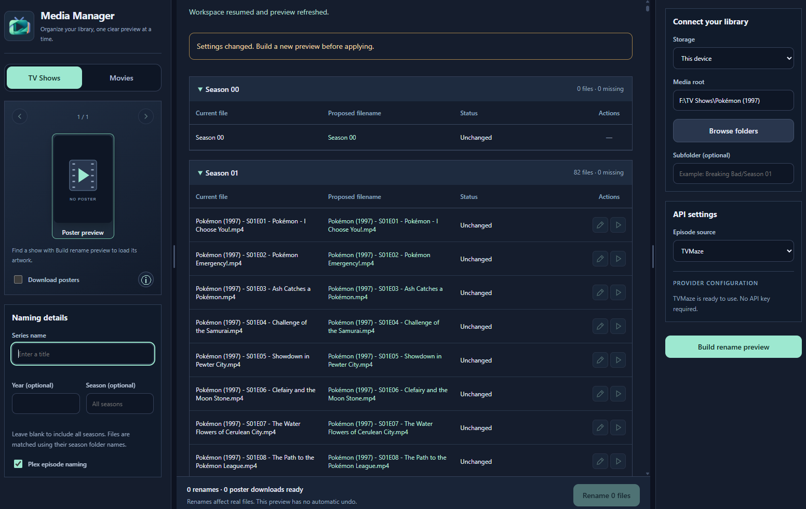

# Media Manager


A Rust desktop and mobile app for organizing TV shows and movies with a clear,
reviewable rename preview. Built with Dioxus, with an optional Axum backend for
controlling a library from another device.

[Releases](https://github.com/exenreco/Media-Manager/releases) ·
[User guide](docs/USER_GUIDE.md) · [Release guide](docs/RELEASING.md) ·
[Apache 2.0 license](LICENSE)



## Features

- TV-show and movie modes, optional season selection, Plex naming and custom templates.
- Season tables with missing episodes, filename edits and media playback.
- Show/season poster previews and optional downloads that preserve existing images.
- Resizable desktop panels; Back/Next steps guide single-column windows through settings, posters and preview.
- Local libraries or an authenticated remote library server.
- Resume saved settings after confirmation, transparent splash and desktop completion notifications.
- Android and iOS native AdMob source integrations with test ads in debug builds.

## Platform status and downloads

This is a **preview**, not a finished five-platform production release. A successful
build is not a substitute for native UI and device testing.

| Platform | Release artifact | Current limits |
| --- | --- | --- |
| Windows x64 | Portable ZIP, app and server | Requires Windows native prerequisites and WebView2 |
| macOS Apple Silicon / Intel | ZIP with app bundle and server | Ad-hoc signed; not Developer ID signed or notarized |
| Linux x64 | TAR.GZ, app and server | Built on Ubuntu 24.04; requires compatible GTK/WebKitGTK runtime |
| Android ARM64 | Installable debug-signed preview APK | Test ads; new native folder access awaits device validation; background execution pending |
| iOS ARM64 Simulator | Simulator app ZIP | For Xcode Simulator, not an installable iPhone IPA; device signing remains pending |

The tag-triggered [release workflow](.github/workflows/release.yml) builds each
platform on its native host and attaches successful artifacts and SHA-256 checksums
to a GitHub prerelease. Assets appear as jobs finish. A missing asset means that
platform job has not completed successfully; check Actions before downloading.
The current source adds Android document-tree selection and iOS security-scoped
folder selection for local previews, renaming, posters and playback. These native
bridges still require native builds and device validation; v0.1.1 downloads do
not contain them. Mobile background jobs and notifications remain unfinished.

The [v0.1.1 prerelease](https://github.com/exenreco/Media-Manager/releases/tag/v0.1.1)
contains successful native CI builds for all rows above. Mobile device acceptance
tests and production/store signing are still pending.

## Build and run

Install stable Rust and the host build tools:

- **Windows:** Visual Studio C++ build tools, Windows SDK and Microsoft Edge WebView2 Runtime.
- **macOS:** Xcode command-line tools.
- **Linux:** GTK 3, WebKitGTK 4.1, libxdo and app-indicator development packages.

On Ubuntu 24.04:

```sh
sudo apt-get install libgtk-3-dev libwebkit2gtk-4.1-dev libxdo-dev libayatana-appindicator3-dev librsvg2-dev
```

From the repository root:

```sh
cargo run -p tv-manager-app --locked
```

Select a media folder, configure naming and metadata, build the preview, inspect
all destinations, and confirm applying it. Renames affect real files; a batch can
partially succeed and has no automatic undo. Existing destination files are never
overwritten. See the [user guide](docs/USER_GUIDE.md) for matching rules and limitations.

## Optional remote server

PowerShell example:

```powershell
$env:TV_MANAGER_ROOT = 'D:\Media'
$env:TV_MANAGER_TOKEN = [Convert]::ToHexString([Security.Cryptography.RandomNumberGenerator]::GetBytes(32))
cargo run -p tv-manager-server --locked
```

The server listens on `127.0.0.1:8787` by default. For access from another device,
put it behind an HTTPS reverse proxy and configure the app with its URL and bearer
token. Keep the token private. See [server configuration and API](docs/USER_GUIDE.md#run-the-remote-backend).

## Mobile development

Use Dioxus CLI **0.7.10** with Android SDK/NDK and Java 17 for Android, or a Mac
with Xcode for iOS. Disable the default desktop feature:

```sh
cd crates/app
dx build --platform android --no-default-features --features mobile
# On a Mac:
dx build --platform ios --no-default-features --features mobile
```

Advertising SDK setup, publisher requirements and native validation:
[Android](crates/app/android/README.md) · [iOS](crates/app/ios/README.md).
iOS needs the documented SDK embedding/signing step before installation/export.
Release CI produces mobile previews with test ads, not store-ready releases.

## Development checks

```sh
cargo fmt --all --check
cargo clippy --workspace --all-targets --locked -- -D warnings
cargo test --workspace --locked
node --test crates/app/android/tests/native-ad.test.cjs crates/app/tests/mobile-storage.test.cjs
python -m unittest discover -s crates/app/ios/tests
```

Native rename tests use temporary libraries, not your media. The live TVMaze test
and desktop notification smoke test are opt-in and ignored during normal CI.
The Windows build and 29 routine Rust tests have passed locally. Cross-platform
build results are recorded in [GitHub Actions](https://github.com/exenreco/Media-Manager/actions).

## Repository layout

| Path | Purpose |
| --- | --- |
| `crates/core` | Metadata, naming, preview plans, file operations and poster downloads |
| `crates/app` | Rust UI and native platform integrations |
| `crates/server` | Authenticated remote API and ticket-based media streaming |
| `assets/branding` | Original icon/splash masters and design notes |
| `scripts` | Release packaging helpers |
| `docs` | User and release documentation |

The original standalone Python renamer is retained as a reference; it is not
required by the Rust application.

## License

Original project code and generated branding are licensed under **Apache 2.0**.
Commercial use, including ad-supported distribution, is permitted. The license
includes an explicit patent grant and allows forks and redistribution; it does
not reserve advertising revenue or exclusive distribution rights to this project.
Copyright © 2026 Exenreco Bell. Dependencies, Google SDKs and provider artwork
retain their own terms; see [third-party notices](THIRD_PARTY_NOTICES.md).
