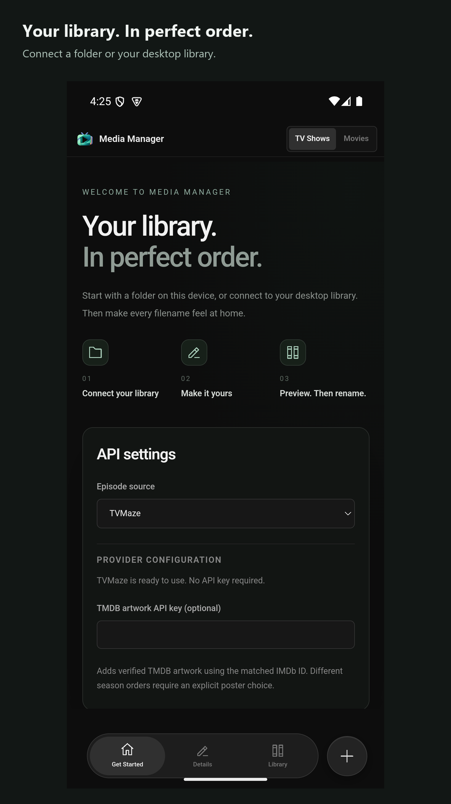
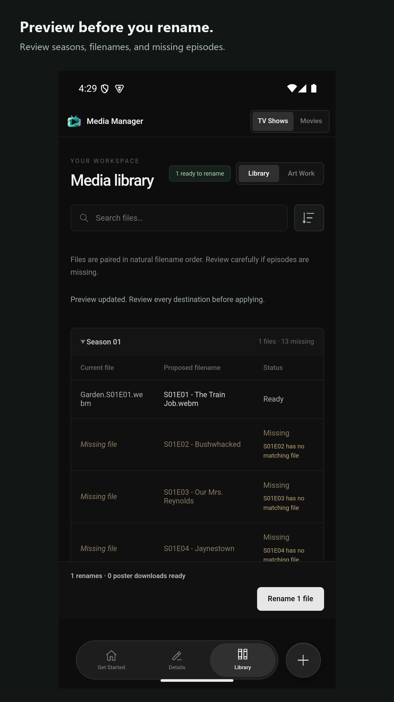
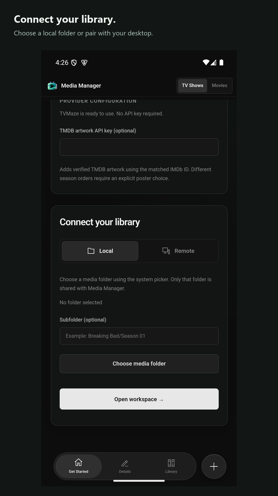
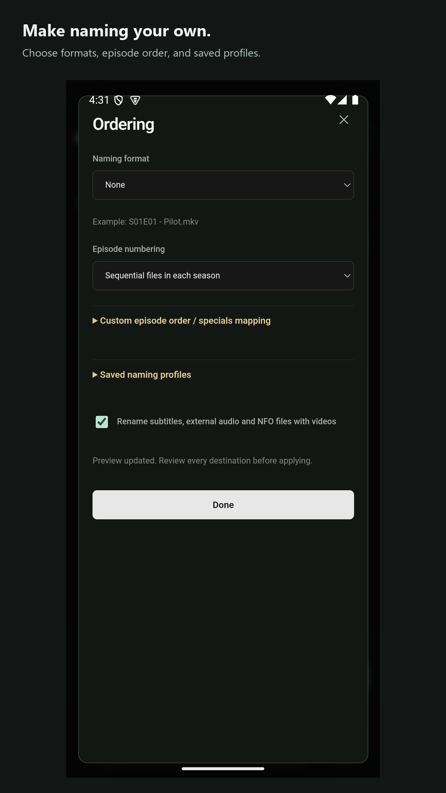

# Media Manager


A Rust desktop and mobile app for organizing TV shows and movies with a clear,
reviewable rename preview. Built with Dioxus, with an optional Axum backend for
controlling a library from another device.

[Releases](https://github.com/exenreco/Media-Manager/releases) ·
[User guide](docs/USER_GUIDE.md) · [Release guide](docs/RELEASING.md) ·
[Apache 2.0 license](LICENSE)

## Screenshots

| Connect your library | Review your media |
| --- | --- |
|  |  |
| **Local or paired libraries** | **Custom naming and ordering** |
|  |  |

Captured Android app screens with presentation captions. Store assets are in
[assets/store/google-play](assets/store/google-play).

Playback compatibility and decoder requirements are documented in [Media playback](docs/PLAYBACK.md).

## Features

- TV-show and movie modes, optional season selection, Plex/Jellyfin naming and custom templates.
- Season tables with missing episodes, filename edits and media playback.
- Local and provider artwork grids, poster comparisons, and explicit replacement controls.
- Responsive icon navigation, custom desktop title bar, media inspector, and mobile bottom sheets.
- Local libraries or an authenticated remote library server.
- Resume saved settings after confirmation, transparent splash and desktop completion notifications.
- Android and iOS native AdMob source integrations with test ads in debug builds.

Version 1.0.0 includes title-match selection, anime absolute
numbering and explicit episode mappings, companion-file renaming, durable rename
history and Undo, alternate TVMaze/TMDB artwork, preview health scans, saved naming
profiles, and single-use QR pairing with a remote server. See
[Library tools](docs/LIBRARY_TOOLS.md) for setup and limits, and
[Mobile validation](docs/MOBILE_VALIDATION.md) for test coverage and device acceptance. These features are included in version 1.0.0.

## Platform status and downloads

Version **1.0.0** is the stable source release. Platform packaging and device
limitations remain listed below; a stable version does not replace device testing.

| Platform | Release artifact | Current limits |
| --- | --- | --- |
| Windows x64 | Setup EXE and portable ZIP | Setup installs WebView2 if missing; publisher signing depends on release configuration |
| macOS Apple Silicon / Intel | PKG installer and portable ZIP | Ad-hoc signed app; installer is not Developer ID signed or notarized |
| Linux x64 | DEB, Flatpak with managed runtime, or TAR.GZ | DEB targets Ubuntu 24.04+ compatible systems; Flatpak supplies GTK/WebKitGTK |
| Android ARM64 | Release-signed APK and Play upload AAB | Release APK uses production ads; ad removal requires Play product/key configuration; physical-device acceptance pending |
| iOS ARM64 Simulator | Simulator app ZIP | For Xcode Simulator, not an installable iPhone IPA; device signing remains pending |

The tag-triggered [release workflow](.github/workflows/release.yml) builds each
platform on its native host and attaches successful artifacts and SHA-256 checksums
to a staging prerelease, promoted to stable after validation. Assets appear as jobs finish. A missing asset means that
platform job has not completed successfully; check Actions before downloading.
The v1.0.0 source and mobile previews include Android document-tree selection and
iOS security-scoped folder selection for local previews, renaming, posters and
playback. Both mobile integrations have compiled in native CI; device/provider
validation is still pending. Mobile background jobs and notifications remain unfinished.

Download [Media Manager 1.0.0](https://github.com/exenreco/Media-Manager/releases/tag/v1.0.0).

The beta release includes Windows setup, macOS PKG and Linux DEB installers
alongside portable downloads and the managed Linux Flatpak. See [desktop installation](docs/INSTALLATION.md)
for setup, upgrade, removal, and runtime requirements.
Platform assets and checksums appear as their native CI jobs finish. Mobile device
acceptance tests and production/store signing are still pending.

## Build and run

Install stable Rust and the host build tools:

- **Windows:** Visual Studio C++ build tools, Windows SDK and Microsoft Edge WebView2 Runtime.
- **macOS:** Xcode command-line tools.
- **Linux:** GTK 3, WebKitGTK 4.1, libxdo and app-indicator development packages.

On Ubuntu 24.04:

```sh
sudo apt-get install libgtk-3-dev libwebkit2gtk-4.1-dev libxdo-dev libayatana-appindicator3-dev librsvg2-dev
```

From the repository root:

```sh
cargo run -p tv-manager-app --locked
```

Connect a local or paired library, then open Library to browse and play its media
files. Browsing does not require a title, year, API key, or provider match. Add
naming and metadata in Details when you want rename suggestions; let the preview
refresh, inspect all destinations, and confirm applying it. Renames affect real files; a batch can
partially succeed; completed operations are recorded for explicit Undo. Existing destination files are never
overwritten. See the [user guide](docs/USER_GUIDE.md) for matching rules and limitations.

## Optional remote server

PowerShell example:

```powershell
$env:TV_MANAGER_ROOT = 'D:\Media'
$env:TV_MANAGER_TOKEN = [Convert]::ToHexString([Security.Cryptography.RandomNumberGenerator]::GetBytes(32))
cargo run -p tv-manager-server --locked
```

The server listens on `127.0.0.1:8787` by default. For access from another device,
put it behind an HTTPS reverse proxy and configure the app with its URL and bearer
token. Keep the token private. See [server configuration and API](docs/USER_GUIDE.md#run-the-remote-backend).

## Signing and Linux runtime

Windows publisher signing is prepared for Azure Artifact Signing but remains
disabled until an identity-validated account and certificate profile are configured.
The release workflow supports Azure Artifact Signing when publisher credentials are configured.
For internal testing, `scripts/sign_windows_local.ps1` creates separately labeled
self-signed builds; these do not establish public publisher trust.

For Linux, use the Flatpak download to install a compatible GTK/WebKitGTK runtime
automatically. See [installation and runtime details](docs/LINUX_RUNTIME.md).
The TAR.GZ remains available for systems with native dependencies installed.

## Mobile development

Use Dioxus CLI **0.7.10** with Android SDK/NDK and Java 17 for Android, or a Mac
with Xcode for iOS. Disable the default desktop feature:

```sh
cd crates/app
dx build --platform android --no-default-features --features mobile
# On a Mac:
dx build --platform ios --no-default-features --features mobile
```

Advertising SDK setup, publisher requirements and native validation:
[Android](crates/app/android/README.md) · [iOS](crates/app/ios/README.md).
iOS needs the documented SDK embedding/signing step before installation/export.
Android release builds use production ad units; debug and iOS Simulator builds use test ads. The separate
[Play bundle workflow](.github/workflows/play-bundle.yml) builds an unsigned ARM64
release AAB targeting API 36, retains native Rust symbols, and exports a matching
`native-debug-symbols.zip`. Sign privately with
[scripts/sign_android_bundle.ps1](scripts/sign_android_bundle.ps1); never publish
upload keys or passwords. See [Android release builds](docs/ANDROID_RELEASE.md).
The existing Play upload uses version code 1000004; the 1.0.0 build uses 1000006.

Android compatibility playback uses bundled LibVLC; iOS uses VLCKit. Desktop and
paired compatibility conversion needs FFmpeg installed on the library host.
See [playback support and limits](docs/PLAYBACK.md) and
[third-party notices](THIRD_PARTY_NOTICES.md).

## Development checks

```sh
cargo fmt --all --check
cargo clippy --workspace --all-targets --locked -- -D warnings
cargo test --workspace --locked
node --test crates/app/android/tests/native-ad.test.cjs crates/app/tests/mobile-storage.test.cjs
python -m unittest discover -s crates/app/ios/tests
```

Native rename tests use temporary libraries, not your media. The live TVMaze test
and desktop notification smoke test are opt-in and ignored during normal CI.
Rust workspace tests and native desktop/mobile packaging checks have passed;
see the validation documents for exact coverage and remaining acceptance checks. Cross-platform
build results are recorded in [GitHub Actions](https://github.com/exenreco/Media-Manager/actions).

## Repository layout

| Path | Purpose |
| --- | --- |
| `crates/core` | Metadata, naming, preview plans, file operations and poster downloads |
| `crates/app` | Rust UI and native platform integrations |
| `crates/server` | Authenticated remote API and ticket-based media streaming |
| `assets/branding` | Original icon/splash masters and design notes |
| `scripts` | Release packaging helpers |
| `docs` | User and release documentation |

The original standalone Python renamer is retained as a reference; it is not
required by the Rust application.

## License

Original project code and generated branding are licensed under **Apache 2.0**.
Commercial use, including ad-supported distribution, is permitted. The license
includes an explicit patent grant and allows forks and redistribution; it does
not reserve advertising revenue or exclusive distribution rights to this project.
Copyright © 2026 Exenreco Bell. Dependencies, Google SDKs and provider artwork
retain their own terms; see [third-party notices](THIRD_PARTY_NOTICES.md).

## Desktop app updates

Desktop builds include Settings → App updates for signed GitHub Release checks, stable/beta channels and verified installer downloads. Updates open the platform installer after media work finishes. See [Desktop updates](docs/UPDATES.md) for signing setup, supported package types and limits. Release CI publishes signed updater metadata when all desktop packages succeed; installer publisher signing is a separate configuration.

## Privacy and support

Read the [privacy policy](https://www.exenreco.com/2026/10/media-manager-privacy-policy)
or its [HTML source](docs/privacy-policy.html). For support, open a
[GitHub issue](https://github.com/exenreco/Media-Manager/issues) or email
[sparksplus22@gmail.com](mailto:sparksplus22@gmail.com).
